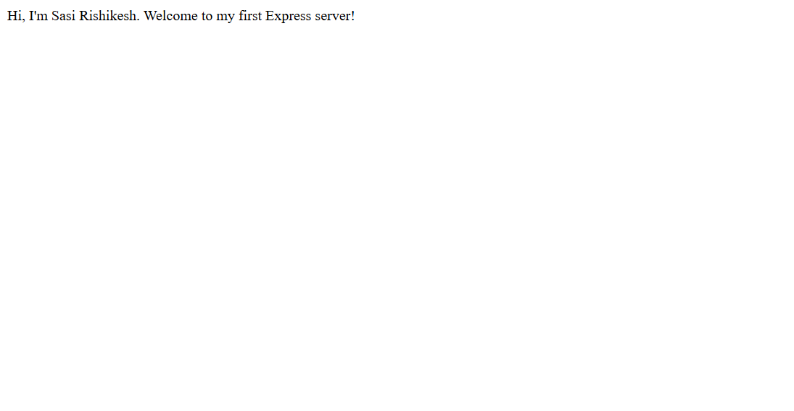
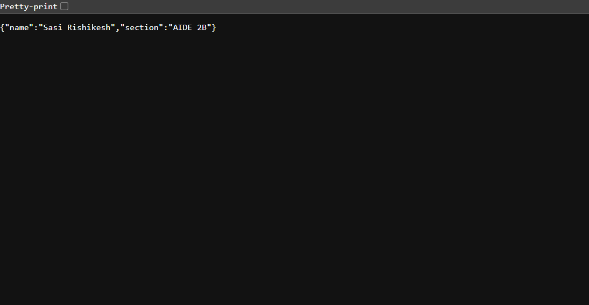
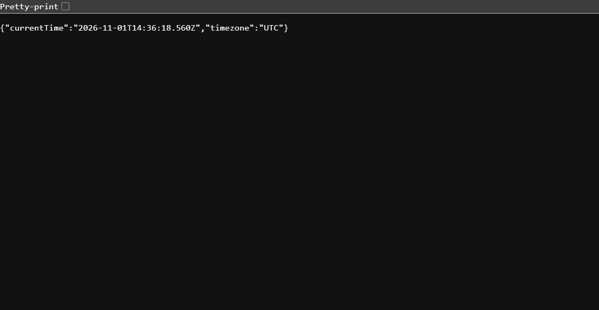
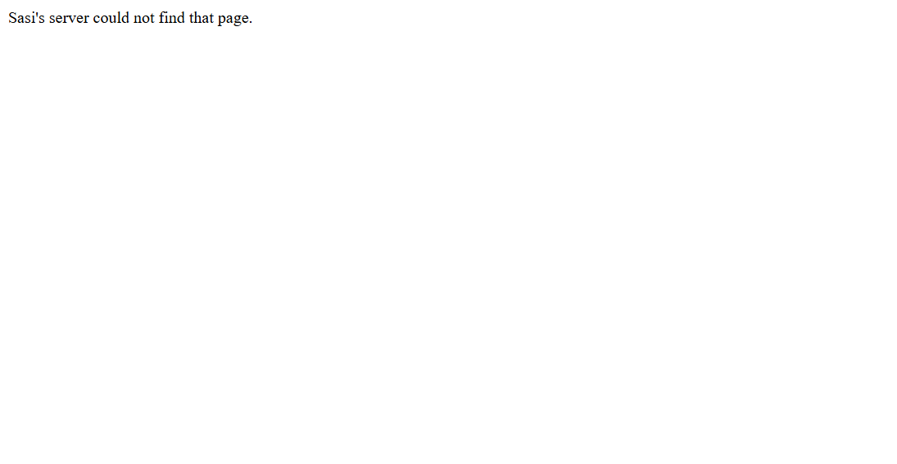

# Lab 1: My Node.js and Express server

| Student detail | Value |
|---|---|
| Name | Sasi Rishikesh |
| Registration number | 252U1R5091 |
| Section | AIDE 2B |

## Live link

Not deployed yet. This lab runs locally; I will add a public URL here if I deploy it.

## What I built

I first used Node.js's built-in `http` module to return `Hello`, then made an Express version with routes for a welcome message, my student details, and the current time. I kept the server small so I can explain what each request handler does.

For my `/time` response, I chose an ISO 8601 timestamp in UTC. That makes the time unambiguous instead of depending on whichever computer runs the server.

## Run it on my computer

I need Node.js and npm installed. From this folder, I install Express and start the Express server:

```bash
npm install
npm start
```

Then I open `http://localhost:3000` in a browser. To try the plain Node.js version instead, I stop the Express server with `Ctrl+C` and run:

```bash
npm run start:http
```

Both examples use port `3000` by default, so I run only one at a time. I can set `PORT` to use another available port. No other environment variables are needed.

## Routes I tried

| Method | Path | What my server returns | Status |
|---|---|---|---:|
| GET | `/` | A welcome message with my name. | 200 |
| GET | `/about` | My name and section as JSON. | 200 |
| GET | `/time` | The current time as an ISO 8601 UTC timestamp. | 200 |
| Any | Any other path | A short not-found message. | 404 |

## Screenshots

These are screenshots of my local server responses:









## What the `package.json` fields mean

- **name** identifies this project in npm.
- **version** is the project's current version.
- **description** briefly says what the project is.
- **main** names the main application file, `server.js`.
- **scripts** gives short commands for starting either server.
- **keywords** describes the technologies used.
- **author** identifies the author of this project.
- **license** records the project's license.
- **type** tells Node.js this project uses CommonJS `require()` syntax.
- **dependencies** lists Express, which `npm install` downloads into `node_modules`.

`package.json` describes the dependencies; `node_modules` contains their installed files. I leave `node_modules` out of Git because it can be recreated with `npm install`.

## What I learned

- `app.listen()` starts Express and waits for requests on a port.
- A request is what the browser sends to my server; a response is what my server sends back.
- The status code tells the browser whether a request worked (`200`) or the path was not found (`404`).
- I use `Ctrl+C` in the terminal to stop a running server.

## Notes

- If Express is missing, I run `npm install` from this folder.
- If port 3000 is already in use, I stop the other server or choose a free `PORT`.
- I do not commit `node_modules` or `.env`.
